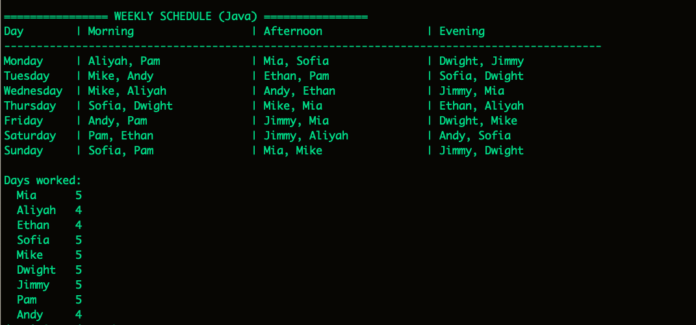
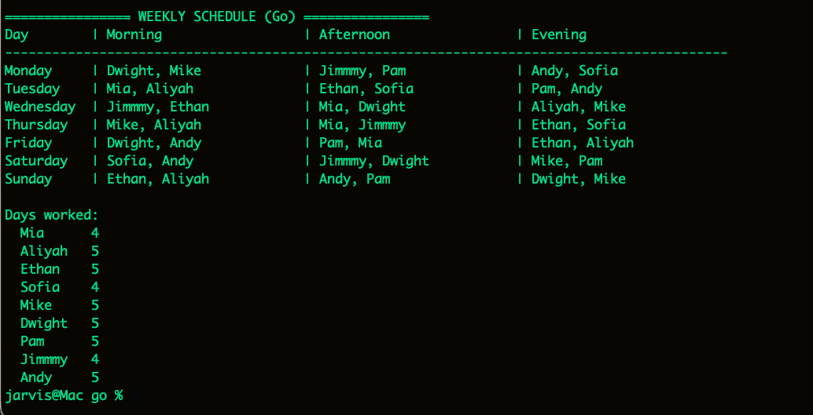

# Employee Shift Scheduler — Java & Go

Schedules employees across 7 days × 3 shifts (Morning, Afternoon, Evening).

- One shift per employee per day, max 5 days per week
- At least 2 employees per shift: gaps are filled randomly from employees who are still available
- Max 3 per shift: if all of an employee's preferred shifts are full, they move to another shift that day, or to the next day if the whole day is full
- Bonus: each day's preferences are ranked (e.g. `M E` = Morning first, Evening second)

## Run

Requires Java 17+ and Go 1.21+. Run these commands from the `assignment_4` folder.

**Java**
```bash
cd java
javac Scheduler.java
java Scheduler
```

**Go**
```bash
cd go
go run .
```

## Input

1. Enter the number of employees (at least 9 are needed to staff every shift).
2. For each employee, enter a name, then their shifts for each day in priority order using `M` (Morning), `A` (Afternoon), `E` (Evening). For example, `M E` means Morning first, Evening second.
3. Leave a day blank for no preference. The random fill may still assign that day.

To skip typing, use the sample input in `input.txt` (run from the `java` or `go` folder):
```bash
java Scheduler < ../input.txt
```
```bash
go run . < ../input.txt
```

## Output




